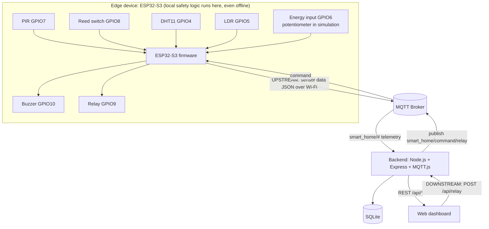

# System Architecture



```
UPSTREAM  (sensor data)
Sensors -> ESP32-S3 -> Wi-Fi -> MQTT Broker -> Backend -> SQLite -> REST API -> Dashboard

DOWNSTREAM (control)
Dashboard -> Backend (POST /api/relay) -> MQTT Broker -> ESP32-S3 -> Relay
                                                           └-> confirms on smart_home/appliance/relay
```
